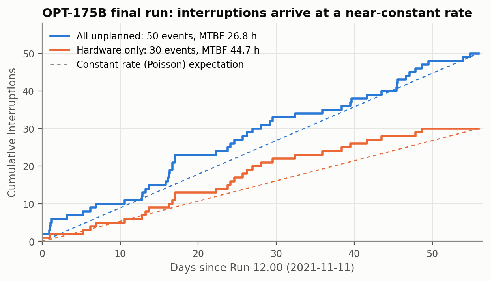
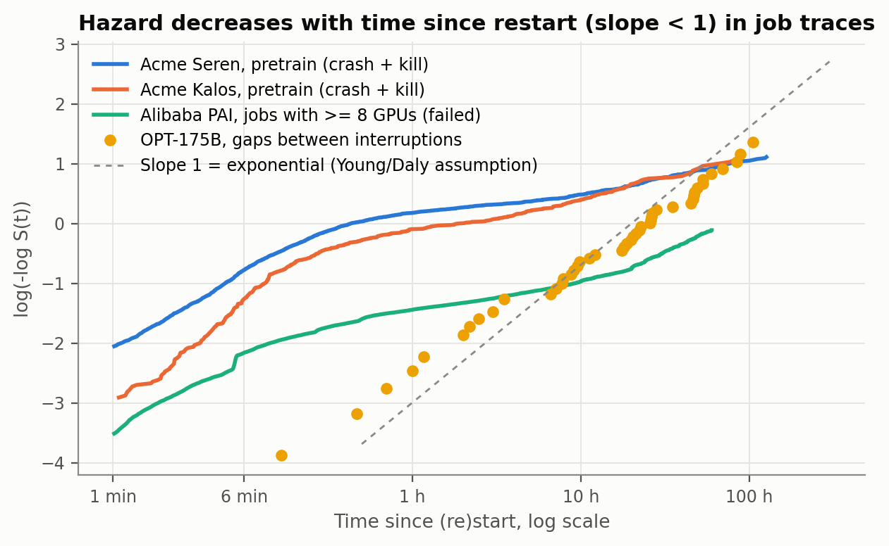
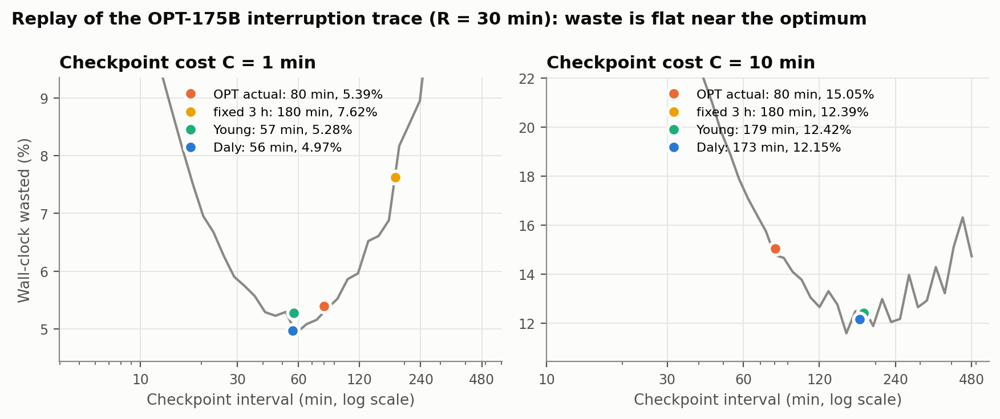
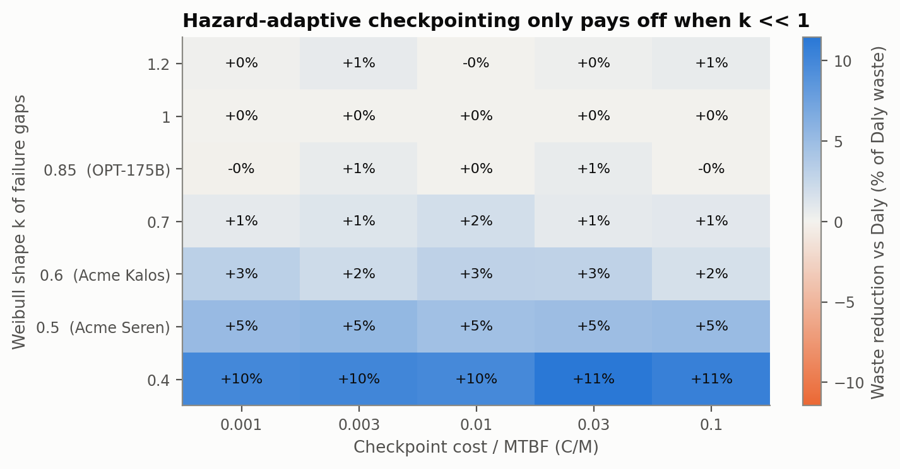

# LLM Training Reliability: Failure Analysis & Checkpoint Optimization

[](https://github.com/ArchanaChetan07/LLM-Training-Reliability-Failure-Analysis-Checkpoint-Optimization/actions/workflows/ci.yml)
 

**Data-driven checkpoint-interval optimization for distributed LLM training, built on survival analysis of real
GPU-cluster failure data from Meta OPT-175B, Shanghai AI Lab Acme, and Alibaba PAI.**

**Author:** Archana Suresh Patil · November 2026

## Project Overview

An end-to-end **machine learning infrastructure** and **reliability engineering** project. It measures how often
large-scale **distributed training** jobs fail on **GPU clusters**, models those failures with **survival analysis**,
and uses the models to choose **checkpoint intervals** that minimize lost training time. The pipeline turns raw
operator logs and **1.9M+ scheduler job records** into failure datasets. It fits **Weibull** and
**proportional-hazards** models, tests the **Young/Daly** optimal-checkpoint formulas against real failure patterns
with a **discrete-event simulator**, and ships a **CLI calculator**, an interactive web calculator, and a drop-in
**PyTorch DDP** checkpoint scheduler. Every reported number is reproducible with `make all`, and **CI (GitHub
Actions)** checks the README against the results on every push.

## Key Results

- **Built a new failure dataset** by hand-coding 119 entries of Meta's 114-page OPT-175B training logbook:
  **50 unplanned interruptions on 992 NVIDIA A100 GPUs over 56 days**, MTBF **26.8 hours** (95% CI 20.4–36.2),
  about 26.6k GPU-hours per interruption.
- **Showed keyword-based log mining is unreliable** for failure analysis: agreement with manual coding of only
  Cohen's κ = 0.38.
- **Reconstructed 700 restart chains from 4,247 LLM pretraining jobs** (Acme). Found that **83% of interruptions are
  invisible** if you count only jobs marked FAILED.
- **Found that jobs fail most right after a restart** (Weibull shape k ≈ 0.5–0.6, against the k = 1 that textbook
  formulas assume). Interruption rate **barely scales with GPU count** (size exponent β ≈ 0.1–0.4, not 1).
- **Tuned checkpoint intervals recover up to 4.2 percentage points of wall-clock training time** compared with a
  fixed 3-hour schedule: about **55k A100 GPU-hours** on an OPT-175B-scale run, with paired bootstrap 95% CIs.
- **Designed a hazard-adaptive checkpoint policy** that cuts wasted compute **3–12% below an online-tuned Daly
  policy** on held-out pretraining runs, with parameters transferred across clusters.
- **Shipped production-style tooling:** `ckpt-calc` CLI, interactive calculator, `OnlineCheckpointScheduler` for
  PyTorch DDP, 36 unit tests, and a CI pipeline on Python 3.10 and 3.12.

## Skills Demonstrated

- **Statistical modeling:** survival analysis, Weibull maximum-likelihood estimation, Kaplan–Meier estimation,
  parametric (Weibull) proportional-hazards modeling, right-censored data, bootstrap confidence intervals, hypothesis testing,
  Poisson point processes, Monte Carlo simulation.
- **ML systems and infrastructure:** distributed training, fault tolerance, checkpointing, GPU cluster reliability,
  MTBF analysis, large-scale LLM pretraining operations, PyTorch Distributed Data Parallel (DDP).
- **Data engineering:** PDF text extraction, log parsing, data annotation and adjudication, ETL over 1.9M+ job
  records, data provenance and checksum-verified reproducibility.
- **Software engineering:** Python packaging, command-line tools, unit testing (pytest), continuous integration
  (GitHub Actions), reproducible research pipelines, technical writing.

## Tech Stack

Python · NumPy · SciPy · pandas · Matplotlib · PyTorch (DDP) · PyMuPDF · pytest · GitHub Actions · HTML/JavaScript

---

## Research Summary

Checkpoint intervals for large training runs are usually set once (e.g. "every 250 updates") and
then left alone. The textbook alternatives, Young (1974) and Daly (2006), pick the interval from the
checkpoint cost *C* and the system MTBF *M*, assuming failures arrive as a memoryless Poisson process.
We test that assumption and the resulting policies against three public sources: Meta's OPT-175B training logbook,
which we hand-code into an interruption trace for the first time; Shanghai AI Lab's Acme traces (NSDI '24);
and Alibaba's PAI GPU trace.

**Findings.**
1. **OPT-175B (992 A100s, 56 days): 50 unplanned interruptions**, MTBF **26.8 h** (95% CI 20.4–36.2), or
   **26.6k GPU-hours per interruption**. 30 of them were hardware (MTBF 44.7 h). At the cluster level the
   gaps are statistically compatible with Poisson: Weibull shape *k* = 0.85 ± 0.10, LRT vs exponential *p* = 0.15,
   and no significant over-dispersion, aftershock excess, or trend.
2. **Per job, the hazard falls steeply after each restart.** Across Acme pretraining runs, the Weibull shape of
   time-to-interruption is *k* = 0.50–0.59 for jobs that survive a 30-min warm-up, and 0.26–0.40 including
   start-up. That's far from the *k* = 1 that Young/Daly assume, and robust to how restart chains are rebuilt.
3. **"MTBF per GPU-hour" is the wrong unit for most interruptions.** The interruption hazard scales with job size
   as *n*^β with β = 0.08 ± 0.05 (Seren) and 0.41 ± 0.16 (Kalos), not β = 1. Only scheduler-reported crashes
   (FAILED/NODE_FAIL) are compatible with linear scaling in GPU count (Kalos β = 1.6 ± 0.55).
4. **Headline.** On the OPT trace, Daly intervals tuned to the observed MTBF recover **0.97 pp of wall-clock
   (95% CI 0.35–1.61) vs OPT's own 80-min schedule** at *C* = 10 s (about 13k A100-hours) and **2.9 pp (1.7–3.9)**
   at *C* = 10 min. At *C* = 1 min the gain, 0.44 pp (−0.01 to 0.95), is not distinguishable from zero. Against a
   generic **3-hour default** with cheap checkpoints, the gain is **2.7–4.2 pp, about 46–73% of the waste a policy
   can control**. OPT's own hand-picked interval was already near-optimal for *C* ≈ 1–5 min, and the optimum is flat:
   being 2× off costs only about 25% more checkpoint-related waste.
5. **When adaptivity matters.** An age-adaptive policy (Daly evaluated at the instantaneous Weibull hazard)
   gains nothing at OPT's cluster scale (*k* = 0.85). On Acme pretraining runs it cuts waste **3–12% below an
   online-tuned Daly** and up to **31% below a fixed 80-min schedule**, using parameters transferred from the
   *other* cluster. It beats the best fixed schedule chosen in hindsight in 5 of 8 settings and ties it
   (within 0.02 pp) in 2 more. A synthetic regime map puts the crossover at *k* ≈ 0.7.

**One-line takeaway.** Tune the interval to the observed failure rate when your fixed schedule is ≥ 2–3× off
(that's when the percentage points add up), and checkpoint more densely right after each restart if your
interruptions are dominated by job-level faults (*k* < 0.7). A drop-in online scheduler and a calculator
are included.

---

## 1. Data

| Source | Unit | Size | What counts as an event |
|---|---|---|---|
| **OPT-175B logbook** (metaseq, 114-page PDF) | dated operator entries | 131 entries; 119 in the final-run window (Run 12.00 → completion, 2021-11-11 → 2022-01-06) | adjudicated unplanned interruption |
| **Acme Seren / Kalos** (Hu et al. NSDI '24) | scheduler jobs | 818k / 62k jobs; **3,607 / 640 Pretrain jobs ≥ 64 GPUs → 624 / 76 restart chains** | crash (FAILED, NODE_FAIL) or operator kill of a run that was resubmitted |
| **Alibaba PAI v2020** (Weng et al. NSDI '22) | jobs | 1.06M jobs | status `Failed` |

Checksums of every analysed byte: [`data/raw/SHA256SUMS`](data/raw/SHA256SUMS). Provenance and licences: [`data/README.md`](data/README.md).

## 2. Methods

### 2.1 Turning the OPT logbook into a failure trace
* **Segmentation.** We use the logbook's own table of contents (131 dated headers) as the entry index, locate
  each header in the body, and slice the text between headers. All 131 are recovered. Timestamps are parsed
  with their ET/PT/CET labels; 31% carry no zone and default to ET, the team's convention.
* **Adjudication.** Every entry in the final-run window was read in full and labelled *hardware / hang /
  infra_software / unknown / optimization / planned / none*, with a one-line justification
  ([`data/annotations/opt_adjudication.csv`](data/annotations/opt_adjudication.csv)). Follow-up entries about an
  already-counted incident get `none`. Where the body states when the job actually died (e.g. an RCA saying
  "2021-12-25 09:56 UTC: job hangs"), that time replaces the entry's timestamp. One entry reporting
  "autorecovery kicked in 3 times in the last few hours" counts as 3 events spread over 4 h.
* **Why manual.** A transparent regex codebook applied to the same entries agrees with the adjudication at
  only **Cohen's κ = 0.38** (51% raw agreement). Keyword mining of operator logs is not reliable enough
  to estimate failure rates.
* **Result.** hardware 30 · hang 9 · infra/software 6 · unknown 5 (= **50 unplanned**) · optimization rollbacks 16 · planned 6.

Unplanned interruptions exclude optimization rollbacks (loss-scale collapse, LR changes). Those are deliberate
and don't depend on the checkpoint interval. The count is a **lower bound**: once auto-recovery was deployed
(2021-12-24), some restarts may have gone unlogged.

### 2.2 Restart chains in Acme
An LLM pretraining run appears in a scheduler trace as a chain of jobs. Consecutive Pretrain jobs of one user
belong to the same chain when (i) their GPU counts differ by ≤ 10%, which allows 512 → 504 after excluding a node,
and (ii) the next job is submitted ≤ 2 h after the previous one ends. Median resubmission gap: 1.1 min (Seren),
1.8 min (Kalos). Each non-final job ended in an interruption, typed by its terminal state: *crash* (FAILED/NODE_FAIL),
*operator kill* (CANCELLED, then resubmitted), *preempted* (PREEMPTED, then resubmitted; counted as unplanned),
or *planned* (COMPLETED/TIMEOUT, then resubmitted). Counting only FAILED/NODE_FAIL would miss **83%** of interruptions to Seren pretraining runs, because operators kill hung runs.
Varying the chain gap over 0.5 / 2 / 6 h moves the Weibull shape by < 0.015.

### 2.3 Survival models
Right-censored Weibull MLE with observed-information SEs and bootstrap CIs; an LRT against exponential;
Kaplan–Meier with Greenwood/log-log bands; exact Poisson (Garwood) CIs on MTBF; and a Weibull proportional-hazards
model in GPU count, *h*(t | n) = (n/512)^β · h₀(t), where β = 1 means GPUs fail independently. All are implemented
directly on numpy/scipy and unit-tested against closed forms ([`tests/`](tests/)).

### 2.4 Clustering tests (OPT)
CV and burstiness of gaps, index of dispersion of daily counts, a 6-h "aftershock" ratio, the Weibull shape of gaps,
and a Laplace trend test. Each comes with a **parametric-bootstrap p-value under the fitted Poisson null**
(5,000 simulations conditioned on *n*), which is the honest test with 50 events.

### 2.5 Policies and simulator
* **Fixed**: OPT's actual 80 min (250 updates × 19.3 s), 1 h, and 3 h.
* **Young** √(2CM), and **Daly**'s higher-order interval, with *M* from the run itself.
* **Online Daly**: *M* re-estimated after every failure from the run's own history, with a Gamma prior
  (2 pseudo-events at a deliberately pessimistic 10 h). Uses no future information, so it's deployable.
* **Weibull-adaptive**: Daly evaluated at the instantaneous hazard *h*(age + τ/2) since the last restart.
  It reduces exactly to Daly when *k* = 1, and checkpoints densely right after a restart when *k* < 1
  (cf. Tiwari et al., DSN '14).
* **Oracle**: the best constant interval in hindsight (upper bound for fixed schedules).

An exact discrete-event simulator replays failure timestamps in wall-clock time. Failures during a checkpoint
write lose the interval, failures during recovery restart it, and time is conserved (property-tested). It matches
Daly's exact exponential-waste formula within 0.4 pp on a 200k-hour Poisson trace. Single-trace replays are averaged
over 64 checkpoint-grid phases, so results don't depend on lucky alignment.

**Evaluation protocol.** (a) in-sample replay of the real OPT trace; (b) **temporal hold-out**: estimate on the
first 28 days, evaluate on the last 28; (c) **paired bootstrap**: 300 synthetic traces resampled from OPT's empirical
gap distribution, the same traces for every policy, giving a 95% CI on each gain; (d) **cross-cluster transfer**:
fit on Seren, test on Kalos runs ≥ 72 h, and vice versa; (e) a **synthetic regime map** over *k* × *C/M*.
We report a grid of *C* ∈ {10 s, 1 min, 5 min, 10 min}: the logbook shows OPT's blocking local save took about 1 s,
with asynchronous blob upload, while a synchronous write of about 2.5 TB of optimizer state to shared storage
takes minutes. Restart downtime is *R* = 30 min, matching the logbook's ~15 min checkpoint load plus requeue
(sensitivity 15 min–2 h in `results/tables/opt_policy_eval.csv`).

## 3. Results

### R1. OPT-175B interruptions arrive at a near-constant rate


| Series | events | MTBF (h) [95% CI] | GPU-h / interruption | gap Weibull *k* | LRT vs exp. *p* | Laplace trend *p* |
|---|---|---|---|---|---|---|
| All unplanned | 50 | 26.8 [20.4, 36.2] | 26,631 | 0.85 ± 0.10 | 0.15 | 0.16 |
| Hardware + hang | 39 | 34.4 [25.2, 48.4] | 34,142 | 0.95 | 0.70 | 0.11 |
| Hardware only | 30 | 44.7 [31.3, 66.3] | 44,385 | 1.19 | 0.24 | 0.11 |

Clustering statistics for all unplanned events, against the Poisson null: CV 1.08 (*p* = 0.18), daily dispersion
index 1.25 (*p* = 0.11), 6-h aftershock ratio 1.22 (*p* = 0.25). The only marginal signal is the gap Weibull shape
(one-sided *p* = 0.046). The visible bursts, e.g. day 16–17 with a string of ECC/IB faults during node bisection,
are within what a Poisson process produces over 56 days.
For scale: the Llama 3 report (2024) gives 419 unexpected interruptions in 54 days on 16k H100s, about 51k GPU-h
per interruption, within 2× of OPT three years later.

### R2. Per job, the hazard is highest right after a (re)start


| Cluster | events | warm-up | *n* | *k* [bootstrap 95%] | GPU-h / event | size exponent β |
|---|---|---|---|---|---|---|
| Seren | crash + kill | none | 3,607 | 0.35 [0.34, 0.36] | 1,651 | 0.02 ± 0.02 |
| Seren | crash + kill | 30 min | 827 | **0.50** [0.47, 0.53] | 7,605 | 0.08 ± 0.05 |
| Seren | crash only | 30 min | 827 | 0.73 [0.60, 0.90] | 88,963 | 0.32 ± 0.16 |
| Kalos | crash + kill | none | 640 | 0.40 [0.38, 0.42] | 3,266 | 0.11 ± 0.09 |
| Kalos | crash + kill | 30 min | 223 | **0.59** [0.52, 0.66] | 9,797 | 0.41 ± 0.16 |
| Kalos | crash only | 30 min | 223 | 0.60 [0.45, 0.83] | 96,569 | 1.58 ± 0.55 |

PAI (mixed ML workload, jobs ≥ 8 GPUs) shows the same shape: *k* = 0.64 after warm-up, 0.39 including start-up.
Caveat: the job table omits `end_time` for 90% of Failed jobs; see §5.

The two views fit together. The *cluster* sees a near-constant stream of node faults (R1), while each *job* is most
fragile in its first hours: bad nodes surface at launch, configuration and data-loader bugs fire early, and
operators kill runs they don't like the look of. Scheduler-reported crashes per GPU-hour (89–97k GPU-h per crash at
Acme) are in the same range as OPT's hardware rate (44k) and Llama 3 (51k). Total interruption rates are an order
of magnitude higher and barely depend on job size.

### R3. Tuned vs fixed intervals on the OPT trace


Paired-bootstrap gain of the tuned policy over each fixed schedule (pp of wall-clock; 300 resampled traces, each
replayed with one shared checkpoint phase for all policies, *R* = 30 min):

| *C* | vs OPT actual (80 min) | vs fixed 1 h | vs fixed 3 h | Online Daly vs OPT actual |
|---|---|---|---|---|
| 10 s | **+0.97** [0.35, 1.61] | **+0.59** [0.17, 1.08] | **+4.17** [2.82, 5.64] | **+1.08** [0.51, 1.74] |
| 1 min | +0.44 [−0.01, 0.95] | +0.31 [−0.14, 0.80] | **+2.72** [1.54, 4.05] | +0.17 [−0.29, 0.67] |
| 5 min | +0.20 [−0.63, 1.02] | **+1.83** [1.05, 2.60] | +0.15 [−1.08, 1.57] | +0.29 [−0.62, 1.20] |
| 10 min | **+2.90** [1.67, 3.95] | **+5.26** [3.82, 6.57] | +0.26 [−0.72, 1.38] | **+2.83** [1.84, 3.89] |

Bold = 95% CI excludes zero.

One percentage point of OPT's 1,342-hour run is about 13.3k A100-hours. The temporal hold-out (estimate on the first
half, test on the second) gives the same picture: e.g. at *C* = 10 min, Daly 11.2% waste vs OPT actual 14.6%.
The online policy is insensitive to its prior: a prior MTBF of 3–100 h changes waste by ≤ 0.6 pp.

### R4. Age-adaptive checkpointing pays off only in the job-level regime


Cross-cluster transfer on Acme runs ≥ 72 h (waste %, *R* = 30 min). All model-based policies use the same size model,
a Weibull proportional-hazards fit in GPU count on the *other* cluster (Seren: *k* = 0.39, β = 0.04 ± 0.02;
Kalos: *k* = 0.42, β = 0.12 ± 0.09):

| test cluster, *C* | fixed 80 min | fixed 1 h | fixed 3 h | Daly | Online Daly | **Weibull-adaptive** |
|---|---|---|---|---|---|---|
| Kalos, 1 min | 6.60 | **6.43** | 8.98 | 7.18 | 6.90 | 6.65 |
| Kalos, 10 min | 16.33 | 18.79 | **13.71** | 14.80 | 14.91 | 13.72 |
| Seren, 1 min | 4.71 | 4.65 | 5.86 | 5.15 | 5.02 | **4.60** |
| Seren, 10 min | 14.42 | 17.10 | 10.35 | 11.75 | 11.34 | **9.97** |

Daly loses to the best fixed schedule in 6 of 8 settings even with the correct size model, and also when *M* comes
from the naive per-GPU-hour rate (β = 1; same 6 of 8). So the failure isn't the rate estimate. With *k* ≈ 0.4 a
single constant interval is the wrong shape. The Weibull-adaptive policy beats the best *hindsight* fixed schedule
in 5 of 8 settings, ties it within 0.02 pp in 2, and loses by 0.22 pp in 1 (Kalos, 1 min). Full table:
`results/tables/acme_policy_transfer.csv`.

### R5. Why the gains are modest, analytically
With waste *W*(τ) ≈ C/τ + τ/(2M), an interval *c*× the optimum costs *W*\*(c + 1/c)/2: 2× off is +25%, 3× off is
+67%, 6× off is +208% of the checkpoint-related waste. OPT's 80-min choice was 1.4× the optimum at *C* = 1 min,
which is why tuning recovers less than half a point there. Fixed defaults chosen without reference to *C*
(the 3-h default with a 10-s async save is 7.8× off; 1 h with a 10-min synchronous save is 2.9× off) are where
the points are.

## 4. Calculator and integration

Interactive version: [`web/checkpoint_calculator.html`](web/checkpoint_calculator.html) (open in a browser; no server needed).

```bash
pip install -e .
ckpt-calc --gpus 992 --ckpt-cost 1m --restart 30m --preset opt175b --current 80m --simulate
ckpt-calc --gpus 4096 --ckpt-cost 2m --gpu-hours-per-failure 50000 --shape 0.6 --current 3h
ckpt-calc --gpus 512 --ckpt-cost 30s --failures 12 --hours 240 --current 1h   # from your own run's history
```

`llm_reliability.checkpointing.OnlineCheckpointScheduler` replaces `if step % ckpt_every == 0` in a training loop. It times its
own saves to learn *C*, persists exposure and failure counts inside the checkpoint, and applies online Daly (or the
Weibull-adaptive rule if given *k*). [`examples/pytorch_ddp_integration.py`](examples/pytorch_ddp_integration.py) shows
it in a PyTorch DDP loop, with an atomic save and the checkpoint decision broadcast from rank 0. Kill the job and
rerun it: it resumes, counts the interruption, and tightens its interval.

```python
from llm_reliability.checkpointing import OnlineCheckpointScheduler

sched = OnlineCheckpointScheduler(prior_mtbf_h=10.0)        # fleet prior; learns the run's own MTBF
if resumed:
    sched.load_state_dict(ckpt["ckpt_sched"]); sched.on_restart()
for step in range(start, total):
    train_step()
    if sched.should_checkpoint():
        with sched.timed_save():                            # measures checkpoint cost C
            save({..., "ckpt_sched": sched.state_dict()})
```

## 5. Threats to validity
* **Logbook coverage.** Entries record operator-visible events; brief automatic restarts may be missing, so the
  OPT rate is a lower bound. Entry time ≠ failure time except where the body states it. Failures logged hours late
  shift gaps but not counts. The adjudication is single-coder; disagreements with the regex codebook are listed per
  entry for audit.
* **Acme chains are inferred.** Operator kills mix hang recovery with discretionary restarts (we report crash-only
  separately). The CANCELLED state can't be disambiguated further from the public trace.
* **PAI censoring is informative.** `end_time` is missing for 90% of Failed jobs in `pai_job_table`, and the 2 GB
  instance table recovers only 6.3% of them. Dropping the rest biases failure rates downward, so we use PAI only for
  the *shape* of the hazard, not its level.
* **Exogenous-failure assumption.** Replays treat failure times as independent of the policy. Long checkpoint writes
  that themselves trigger I/O faults (the logbook records blob-upload failures) aren't modelled.
* **Cost model.** *C* and *R* are swept, not measured per run. The headline is quoted per *C* for that reason.

## 6. Reproduce
```bash
git clone https://github.com/ArchanaChetan07/LLM-Training-Reliability-Failure-Analysis-Checkpoint-Optimization.git
cd LLM-Training-Reliability-Failure-Analysis-Checkpoint-Optimization
pip install -e ".[dev]"
make data     # ~1 GB download, ~3 GB extracted, checksummed (raw data is not in the repo)
make test     # 36 tests
make all      # ~5 min; writes results/ and verifies every README number against it
```

## 7. Repository layout
```
├── src/llm_reliability/
│   ├── data/            opt_logbook.py (PDF → coded trace) · acme.py (restart chains) · pai.py
│   ├── stats/           survival.py (Weibull, KM, size model) · clustering.py (Poisson-null tests)
│   ├── checkpointing/   policy.py (policies + replay simulator) · scheduler.py (online scheduler)
│   ├── cli.py           ckpt-calc
│   └── plotting.py
├── scripts/             download_data.sh · run_analysis.py · check_readme_numbers.py
├── data/                README.md (provenance) · raw/SHA256SUMS · annotations/ (hand-coded) · processed/
├── results/             figures/ · tables/ · metrics.json
├── examples/            pytorch_ddp_integration.py
├── web/                 checkpoint_calculator.html
└── tests/               test_policy · test_survival · test_data_parsing · test_scheduler
```

## References
Young, J. W. (1974). A first order approximation to the optimum checkpoint interval. *CACM* 17(9).
Daly, J. T. (2006). A higher order estimate of the optimum checkpoint interval for restart dumps. *FGCS* 22(3).
Tiwari, D., Gupta, S., Vazhkudai, S. (2014). Lazy checkpointing: exploiting temporal locality in failures. *DSN*.
Zhang, S. et al. (2022). OPT: Open Pre-trained Transformer Language Models. arXiv:2205.01068 (logbook in metaseq).
Hu, Q. et al. (2024). Characterization of Large Language Model Development in the Datacenter. *NSDI*.
Weng, Q. et al. (2022). MLaaS in the Wild: Workload Analysis and Scheduling in Large-Scale Heterogeneous GPU Clusters. *NSDI*.
Llama Team (2024). The Llama 3 Herd of Models. arXiv:2407.21783, §3.3.4.
Goh, K.-I., Barabási, A.-L. (2008). Burstiness and memory in complex systems. *EPL* 81.
